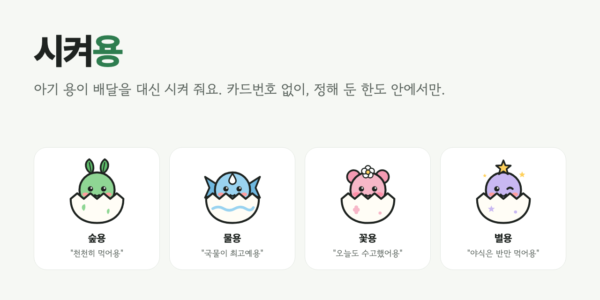

<p align="center">
  
</p>

# 시켜용

**아기 용이 배달을 대신 시켜 줍니다. 카드번호는 맡기지 않고, 정해 둔 한도 안에서만 씁니다.**

"점심 시켜 줘" 한마디면 용이가 날씨, 동네, 이번 달 예산을 보고 메뉴를 골라 옵니다. 주문은 화면의 확인 버튼을 눌러야만 결제됩니다. 결제는 한도가 걸린 원화 스테이블코인(OKRW)으로 합니다. 그 한도는 앱이 아니라 [마루](https://docs.maroo.io) 체인이 지킵니다. 그래서 AI가 속거나 서버가 뚫려도 주문 경로로는 한도보다 큰돈이 나가지 않습니다.

시켜용은 마루의 대표 레퍼런스 디앱입니다. 다른 개발자가 세 가지 패턴을 가져다 쓰게 하는 것이 목표입니다: 에이전트 결제, PCL 정책 묶음, 가맹점 결제 컨트랙트.

## 데모 영상

<!-- 영상: GitHub 웹 편집기에서 이 자리에 mp4를 끌어다 놓으면 user-attachments 주소가 생기고 바로 재생됩니다. -->
_준비 중_

## 무엇을 하나

| | |
| --- | --- |
| **알아서 시켜 줌** | "점심 시켜 줘" → 추천 → 확인 카드 → 버튼을 누르면 결제. 말로 "응"만 해서는 결제되지 않습니다 |
| **잔소리** | "이번 달 배달비 21만 원 썼어용, 주말엔 집밥 어때용?" 예산의 70%부터 알려 줍니다 |
| **키울수록 한도가 오름** | 레벨 1은 한 번에 1만 원, 레벨 3은 5만 원. 레벨을 올리려면 주인이 다시 인증해야 합니다 |
| **멈춤 버튼** | 주인이 언제든 용이를 멈추고 남은 용돈을 돌려받습니다 |
| **용 도감** | 고른 알에 따라 숲용, 물용, 꽃용, 별용이 태어납니다. 생김새만 다르고 돈 규칙은 같습니다 |

## 왜 카드 대신 체인 한도인가

요즘 AI 비서는 이미 결제를 합니다. 다만 대부분은 저장된 카드로 결제하고, 지키는 것은 앱의 승인 화면 하나입니다. 그래서 AI가 속으면 카드 한도까지 위험해집니다. 시켜용은 이 구조를 바꿉니다:

| 장면 | 시켜용이 하는 일 |
| --- | --- |
| 원화 결제 | 카드번호 없이 OKRW로 결제합니다 |
| 체인이 지키는 한도 | 건당 한도와 30일 한도를 넘는 주문은 앱이 아니라 체인 정책(PCL)이 실행 중에 되돌립니다 |
| AI 신분증 | ERC-8004로 등록한 에이전트이고 주인 KYC와 묶여 있습니다. 가게는 따로 확인하지 않아도 됩니다 |
| 빼돌리기 피해 상한 | AI 지갑에는 주문 한두 번 분량만 둡니다. 새 주소로 빼돌려도 그 소액뿐입니다 |
| LLM에게 돈 도구 없음 | 모델이 부를 수 있는 것은 조회, 견적, 승인 요청, 한도 변경 제안 카드뿐입니다. 돈을 옮기는 도구는 없습니다 |

과장하지 않습니다. 정확한 범위는 이렇습니다: 주문 경로의 큰돈은 체인이 막고, 우회 경로로는 지갑에 둔 소액만 잃습니다 (결정 D-02, D-06).

## 상태 (2026-11-19)

1단계 목표는 **2026-12-09 테스트넷 데모**입니다.

- [x] UI 컴포넌트 35개 (Storybook 하네스, 테스트, 위키 포함)
- [x] 용이 대화 루프: 도구 8개, 인젝션 안전장치, 대화를 재생하는 테스트 하네스, Claude 연결
- [x] DB 핵심 스키마, 예산 계산(개인 월 예산, 이번 달 사용액, 체인 30일 사용량)
- [ ] 화면 조립 (apps/web), 주문과 결제 API, 컨트랙트 배포, 목 가게 시드

1단계의 정직한 한계:
- 운영자 계정이 모든 에이전트의 소유자입니다 (MAWS 멀티테넌트 미확인).
- 30일 한도 장면은 주기를 줄인 데모 프로필로 보여 줍니다.
- 에이전트 지갑의 직접 송금은 체인이 막지 못하므로, 지갑에는 소액만 둡니다.

자세한 내용은 [docs/wiki/product/vision.md](docs/wiki/product/vision.md)에 있습니다.

## 구조

```
apps/web        Next.js 사용자 웹 (페이지는 조립만)
apps/api        NestJS. 사용자 API, 에이전트 런타임(Claude), 결제 어댑터, 인덱서
packages/ui     UI 컴포넌트. 컴포넌트마다 본체, 하네스(Storybook), 테스트
packages/shared 타입, zod 스키마, 체인 설정, 정책값, 에러 코드, 금액·시간 유틸
design          시안, 유저 플로우, 디자인 토큰
contracts       Foundry. SikyeoyongOrders (PCL 프록시 뒤)
infra           docker compose, Caddy, 배포 스크립트
seed            목 가게·메뉴 시드
docs            기획, 기술 기획, 결정 기록, 위키
```

## 빠른 시작

```bash
pnpm install
cp .env.example .env        # 값 채우기 (비밀은 커밋 금지)
pnpm db:migrate && pnpm db:seed
pnpm dev                    # api + web
pnpm ui:harness             # 컴포넌트 하네스(Storybook)만 보기
pnpm test                   # 단위·통합 테스트
```

테스트넷 자금은 https://faucet.maroo.io 에서 받고, 탐색기는 https://explorer-testnet.maroo.io 입니다.

## 문서 지도

| 문서 | 내용 |
| --- | --- |
| [docs/pitch.md](docs/pitch.md) | 한 장 요약 |
| [docs/plan.md](docs/plan.md) | 기획서 |
| [docs/tech-spec.md](docs/tech-spec.md) | 기술 기획 (API, 데이터, 컨트랙트, 인프라) |
| [docs/_research/decisions.md](docs/_research/decisions.md) | 결정 기록 (다른 문서와 다르면 이 파일이 맞다) |
| [docs/_research/maroo-facts.md](docs/_research/maroo-facts.md) | 마루 사실 확인 기록 |
| [docs/wiki/README.md](docs/wiki/README.md) | 컴포넌트 규칙 위키 (ROOT) |
| [design/README.md](design/README.md) | 시안과 디자인 규칙 |
| [CLAUDE.md](CLAUDE.md) | AI 에이전트 작업 진입점, 절대 규칙 |
